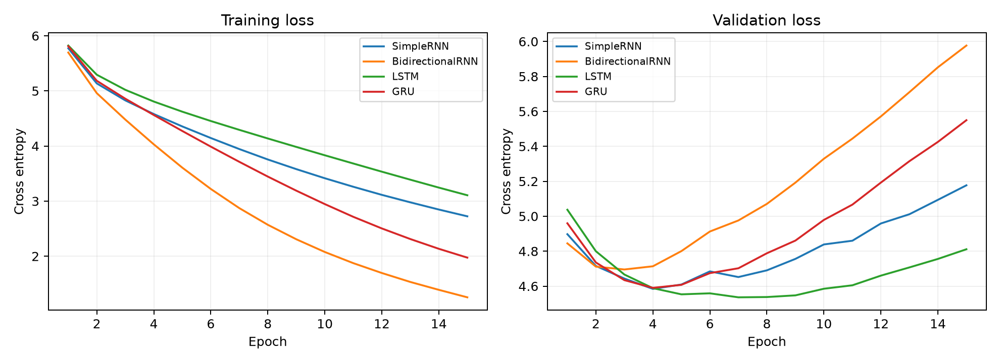
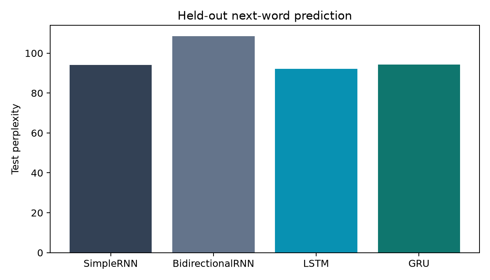

# Autoregressive text generation on The Time Machine

**Riya Noushad | 230953602 | ICT4403 Foundations of Generative AI | Assignment 2**

## Objective and conclusion

Implement and train Simple RNN, Bidirectional RNN, LSTM and GRU models to predict the next word and generate text autoregressively. Compare held-out prediction, runtime and generated text at three sampling temperatures.

**LSTM is the strongest model in this experiment:** its validation loss is lowest, test perplexity is 92.14 and test accuracy is 21.09%. Its advantage over the Simple RNN is small (about 2.1% lower test perplexity), so this single run does not establish a universal architecture ranking. None of these small models produces reliably coherent long-form prose. Temperature 0.5 gives the most readable local phrases among the tested settings, but also produces repetition.

## Dataset and source

The dataset is H. G. Wells's English science-fiction novella *The Time Machine*. Its narration, dialogue, descriptions and recurring terms such as time traveller, machine and Morlocks make it suitable for studying local word dependencies and domain vocabulary. A single book also makes data sparsity and overfitting visible.

- Official source: https://www.gutenberg.org/ebooks/35
- UTF-8 download: https://www.gutenberg.org/ebooks/35.txt.utf-8
- The original downloaded file, including its Project Gutenberg license, is bundled as `data/time_machine.txt`.
- SHA-256: `2892e919000e17c83e1dac51b30f4675db50536b644d7579fe8a89bb399a9bdc`
- Processed narrative: 32,693 word tokens and 4,623 distinct word types.
- Training vocabulary: 1,882 entries including `<unk>`.

Project Gutenberg identifies the work as public domain in the USA; its original distribution notice is retained in the dataset. The bundled snapshot and checksum make this run reproducible even if the online edition changes.

## Preprocessing and input construction

Remove Project Gutenberg front and back matter, the title and contents. Begin with the first narrative sentence. Lowercase, normalize curly apostrophes and tokenize with `[a-z]+(?:'[a-z]+)?`. Internal apostrophes are retained; digits and punctuation are discarded. Hyphenated forms become separate words. Chapter heading words within the narrative remain. The task therefore predicts words, not punctuation or capitalization, and the output is deliberately unpunctuated.

Split the token stream chronologically into 80% training, 10% validation and 10% test **before** making windows. The splits contain 26,154 / 3,269 / 3,270 tokens, producing 26,142 / 3,257 / 3,258 examples. Each example has 12 context words and one next-word target; stride is one. For tokens `w0 ... w12`, the input is `w0 ... w11` and the target is `w12`. No window crosses a split boundary. Overlapping windows within each split are expected, but there is no shared boundary context between splits.

Build the vocabulary from training words with frequency at least two. Map remaining words to `<unk>`; do not inspect validation or test words when building the vocabulary. Unknown-token rates are 8.52%, 13.74% and 14.71% in the respective token splits. This is a substantial limitation: reported perplexity is over the reduced vocabulary, not all original word identities. Overall accuracy can be increased by correctly predicting `<unk>`, so known-target accuracy is also reported. It excludes unknown targets without changing the model's predicted class.

Chronological splitting is stricter than randomly mixing overlapping windows, although the final portions of the story can differ in vocabulary and subject matter. This is a single-book evaluation, not evidence of general English language ability.

## Models and comparable training conditions

All models use a trainable 64-dimensional embedding, one recurrent layer with 96 hidden units per direction and a linear projection to 1,882 vocabulary logits. A softmax gives next-word probabilities. Simple RNN uses a tanh recurrent update; LSTM uses input, forget and output gates plus a cell state; GRU uses reset and update gates. The bidirectional model uses two tanh RNN directions and concatenates their final hidden states.

**The bidirectional model sees only the 12 observed context words.** Its reverse direction traverses this known prefix, never the target or later text. The concatenation uses the final hidden state of each direction rather than the last output timestep alone. During generation, the prefix is re-encoded for every next word, so its use is autoregressive and does not leak future words.

Every model receives the same split, vocabulary, 15 epochs, batch size 128, Adam optimizer, learning rate 0.002, cross-entropy objective and gradient norm clipping at 1.0. There is no dropout or architecture-specific tuning. Seed 42 is reset before each model, and training-loader shuffling uses its own seed 42 generator. Training is on CPU with four threads and deterministic PyTorch algorithms. Each model completes all 15 epochs; the checkpoint with minimum validation loss is selected. Test data is evaluated after selection and is never used for optimization or checkpoint choice.

This controls the data and optimization budget, not parameter count: the bidirectional model has more parameters. Runtime includes the training loop, validation and checkpoint writes, excluding preprocessing, final test evaluation and generation. Times depend on this machine and are not universal speed claims. Exact environment and processor information are in `results/config.json`.

## Execution

Use Python 3.12. From this repository folder:

```bash
python -m venv .venv
# Windows PowerShell
.venv\Scripts\Activate.ps1
# macOS/Linux alternative: source .venv/bin/activate
python -m pip install -r requirements.txt
python train.py --epochs 15 --threads 4
python evaluate_extra.py
python generate.py --model LSTM --seed "the time traveller was" --temperature 0.5 --length 60
```

The included weights can generate text immediately after installing dependencies; retraining is optional. `train.py` overwrites model checkpoints, raw metrics, histories, samples and plots. `evaluate_extra.py` refreshes supplementary metrics. The README, readable sample collection and temperature table document the supplied run and must be updated if a rerun changes the settings or results. CPU/backend versions and thread scheduling can affect runtime and numerical results.

## Quantitative results

Cross entropy is the mean negative natural-log probability of the correct next token; perplexity is `exp(cross_entropy)`. Accuracy is the fraction of correct argmax predictions. Lower loss and perplexity are better; higher accuracy is better.

| Model | Parameters | Best epoch | Test loss | Perplexity | Accuracy | Known-word accuracy | Training time (s) |
|---|---:|---:|---:|---:|---:|---:|---:|
| SimpleRNN | 318,554 | 4 | 4.5441 | 94.07 | 19.92% | 13.27% | 28.86 |
| BidirectionalRNN | 514,778 | 3 | 4.6865 | 108.47 | 19.21% | 13.88% | 48.36 |
| LSTM | 365,210 | 7 | 4.5233 | 92.14 | 21.09% | 14.56% | 44.92 |
| GRU | 349,658 | 4 | 4.5453 | 94.19 | 20.50% | 14.20% | 53.81 |


An add-one-smoothed training unigram baseline has test loss 5.2404, perplexity 188.75 and accuracy 14.64%. It predicts the most frequent training token for accuracy, which here is `<unk>`. All four recurrent models improve on this context-free baseline. The known-target denominator is 2,781 of 3,258 test examples.

LSTM has the best loss, perplexity, overall accuracy and known-target accuracy. The Simple RNN is fastest and nearly matches its perplexity, making it an attractive small baseline. GRU is competitive but took longer than LSTM on this CPU; gate count alone does not determine runtime. Bidirectional RNN has the largest parameter count and worst held-out perplexity despite reducing training loss aggressively.





Validation loss begins rising while training loss continues falling. The best epochs are 4, 3, 7 and 4 respectively. The bidirectional model's additional capacity appears to amplify overfitting in this setup. LSTM retains its best validation performance later, but the differences are too small and the run count too limited to establish statistical significance.

## Sampling experiment

Sample a next token using `softmax(logits / T)` and append it to the context, retaining at most the most recent 12 tokens. For seeds shorter than 12 words, use the available prefix without padding. Suppress `<unk>` only during generation to avoid unreadable placeholders; evaluation uses the full vocabulary. This means sampled text uses a slightly modified distribution from the one used to compute perplexity. There is no top-k, nucleus sampling or repetition penalty.

The three fixed seeds are `the time traveller was`, `i looked around me` and `the machine was standing`. Every model uses temperatures 0.5, 1.0 and 1.5. Generate 60 new words for each combination, with three random replicates: 4 models x 3 prompts x 3 temperatures x 3 replicates = **108 continuations**. Random seeds are `1000 + 10*prompt_index + replicate`, reused across models and temperatures for paired comparisons. No generated text is hand-edited. See `results/samples.json` and `results/generated_samples.md` for all outputs.

Distinct-1 is unique generated words divided by 60. Distinct-2 is unique adjacent generated word pairs divided by 59. Repeated-bigram fraction is one minus Distinct-2. These are descriptive lexical metrics, not measures of semantic coherence, and the latter two are mathematically redundant. Each table value averages nine equally long outputs (three prompts x three replicates); prompt tokens are excluded.

| Model | Temperature | Distinct-1 | Distinct-2 | Repeated bigrams |
|---|---:|---:|---:|---:|
| SimpleRNN | 0.5 | 0.489 | 0.782 | 0.218 |
| SimpleRNN | 1.0 | 0.789 | 0.991 | 0.009 |
| SimpleRNN | 1.5 | 0.896 | 1.000 | 0.000 |
| BidirectionalRNN | 0.5 | 0.585 | 0.870 | 0.130 |
| BidirectionalRNN | 1.0 | 0.804 | 0.994 | 0.006 |
| BidirectionalRNN | 1.5 | 0.920 | 1.000 | 0.000 |
| LSTM | 0.5 | 0.593 | 0.881 | 0.119 |
| LSTM | 1.0 | 0.822 | 0.998 | 0.002 |
| LSTM | 1.5 | 0.907 | 1.000 | 0.000 |
| GRU | 0.5 | 0.530 | 0.836 | 0.164 |
| GRU | 1.0 | 0.778 | 0.991 | 0.009 |
| GRU | 1.5 | 0.911 | 1.000 | 0.000 |


### Qualitative assessment

At **T=0.5**, sharper distributions favor familiar phrases. Simple RNN repeats "the morlocks of the morlocks" and "the time traveller"; GRU repeatedly returns to "the time machine". Bidirectional RNN produces locally grammatical fragments such as "i could not find the time machine", but fails to maintain a single scene. LSTM produces fragments such as "i had seen upon me in the time machine" and "i had a kind of the night". These preserve the book's vocabulary, but their meaning remains weak. LSTM is somewhat more varied locally than the most repetitive Simple RNN output, not consistently coherent in a narrative sense.

At **T=1.0**, more vocabulary is explored, but grammatical and contextual consistency deteriorate. For example, LSTM's continuation includes "animals upon a few resemblance" and later "the reason of a peculiar well". The three prompts do not reliably anchor a meaningful continuation. Model outputs contain recognizably domain-related terms without maintaining events, entities or cause and effect.

At **T=1.5**, flattening the distribution brings in rarer words and reduces repeated bigrams, but produces sequences such as GRU's "we walls quietly only one's true type an air abundant". High lexical diversity here is largely random variation rather than better writing. Temperature cannot repair a poorly learned language distribution.

These observations are a manual reading of fixed examples, not blinded human scores. Complete samples are retained to make the judgments inspectable. The lexical metrics describe trends averaged over prompts and replicates; they should not be treated as proof of semantic quality.

## Recommendation and limitations

Use **LSTM at temperature 0.5 among the tested options** when local readability is the priority. It has the best held-out prediction measures, and lower temperature gives more recognizable phrases than 1.0 or 1.5. For longer creative prose, none of the four systems is adequate in this configuration. The Simple RNN offers a faster alternative with only a small predictive penalty.

Limitations include a small single-book corpus, high unknown-word rates, punctuation removal, a 12-word context, unequal parameter counts and only one training seed. Three sampling replicates characterize generation randomness, not training uncertainty. The chronological test split may shift topic. A stronger follow-up would compare several training seeds, a larger corpus, subword tokenization, longer contexts, dropout and matched parameter budgets, then obtain blinded human coherence ratings. Such experiments were not run and no results are claimed for them.

## Repository contents and submission

- `train.py`: preprocessing, models, training, checkpoint selection, evaluation, sampling and plots.
- `generate.py`: command-line generation from saved weights.
- `evaluate_extra.py`: unigram baseline and known-target accuracy.
- `data/time_machine.txt`: original dataset and distribution notice.
- `models/`: four selected checkpoints and the training vocabulary.
- `results/`: raw JSON and CSV measurements, learning curves and all generated samples.
- `requirements.txt`: versions used for the experiment.

Destination repository: https://github.com/riyanoushad/FGAI-IA-2. If private, give the evaluator access. The separate student cover files contain Riya Noushad's name and registration number; the repository URL has been added. Upload the completed cover PDF to the LMS. LMS submission remains a separate final step.
